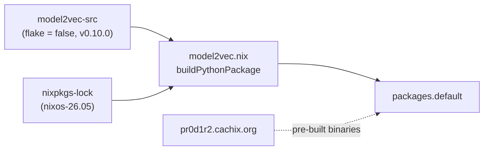
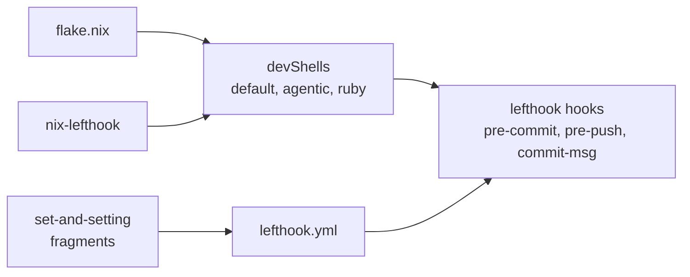

# nix-model2vec

<!-- hallucinogen:autonomy-disclaimer start -->
> Read [LLM-DISCLAIMER](docs/LLM-DISCLAIMER.md) first. This repository is
> tended by an autonomous loop, and that file says what the loop may do here,
> what it may not, and what to check before trusting anything in this tree.
<!-- hallucinogen:autonomy-disclaimer end -->

[](https://github.com/pr0d1r2/nix-model2vec/actions/workflows/ci.yml) [](https://nixos.org)

Nix package for [model2vec](https://github.com/MinishLab/model2vec) — fast state-of-the-art static embeddings. Pre-built binaries served via [cachix](https://pr0d1r2.cachix.org).

## Usage

### As a flake input

```nix
{
  inputs.nix-model2vec = {
    url = "github:pr0d1r2/nix-model2vec";
    inputs.nixpkgs.follows = "nixpkgs";
  };

  # In devShell packages:
  nix-model2vec.packages.${system}.default
}
```

## Binary cache

model2vec is cached via [cachix](https://pr0d1r2.cachix.org). The flake includes `nixConfig` with the substituter, so `nix build` pulls pre-built binaries instead of compiling.

To accept the cache without prompts, add to `~/.config/nix/nix.conf`:

```ini
trusted-substituters = https://pr0d1r2.cachix.org
trusted-public-keys = pr0d1r2.cachix.org-1:NfWjbhgAj41byXhCKiaE+av3Vnphm1fTezHXEGsiQIM=
```

## Architecture



## Development architecture



## License

MIT
